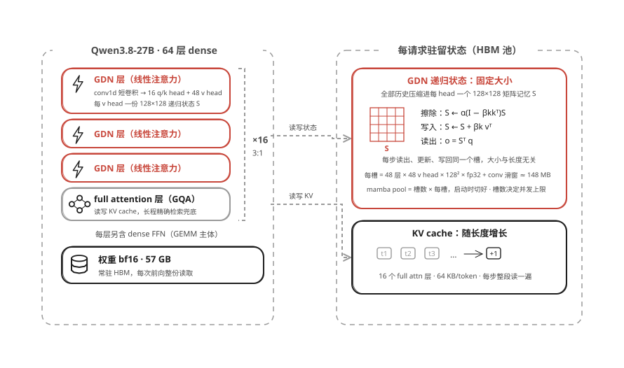
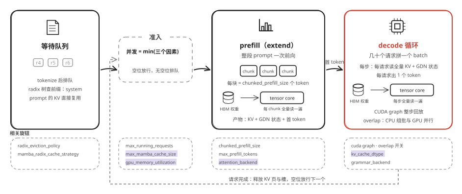

*GDN + full attention 混合架构模型在 SGLang 里怎么用显存，以及怎么切两个 cache 池把并发打满。*

系列（按顺序阅读）：1. [混合注意力 LLM 离线推理](/HybridModelConcurrency/) · 2. [推理瓶颈在哪](/InferenceCostModel/) · 3. [提高推理 QPS](/OfflineInferenceOptimizationLog/) · 4. [稀疏 MoE 与 FP4](/BeyondH100/)

---

## 1. 模型：Qwen3.8-27B

Qwen3.8-27B 是混合架构：64 层里 GDN（Gated DeltaNet，线性注意力）和 full attention 按 3:1 交替，每 4 层一组（3 层 GDN + 1 层 GQA，即分组查询的 full attention），共 48 + 16 层；每层另含 dense FFN，无 MoE。bf16 权重约 57 GB。

对推理吞吐而言，这个结构的要点是**每个请求的驻留状态分两种**：

- KV cache：只有 16 个 full attention 层产生，随长度线性增长，64 KB/token（bf16）。decode 每步要把它整段 sequence 读一遍。
- GDN 递归状态：48 层合计 148 MB/req，固定大小，与长度无关。decode 每步读出、更新、写回同一个槽。

两种状态各占一个显存池：kv cache 和 mamba cache（SGLang 复用 Mamba 模型的状态缓存来存 GDN 递归状态，所以这个池叫 mamba cache，按槽 slot 分配，每槽 148 MB）。两池合起来受 `gpu_memory_utilization`（gmu，引擎可用显存占整卡的比例）约束。

对吞吐而言，我们真正关心的是同时驻留多少个请求。设序列长度 $$L$$（输入 + 已生成）、并发请求数 $$n$$。离线推理常见的长输入、短输出负载里，decode 相比 prefill 很少，序列长度可以近似成输入 prompt 长度。

$$\text{KV cache} = n \times L \times 64\text{KB}, \qquad \text{mamba cache} = n \times 148\text{MB}$$

$$\frac{\text{KV cache}}{\text{mamba cache}} = \frac{L \times 64\text{KB}}{148\text{MB}} \approx \frac{L}{2.4\text{K}}$$

我们需要根据这个比例调整两池大小，以达到极致的并发：$$L \approx 2.4\text{K}$$ 时两池等大；$$L$$ 越长 KV 池占比越高（$$L = 12\text{K}$$ 时 KV 池应约为 mamba 池的 5 倍）。

---

## 2. 推理引擎 SGLang：Request 生命周期

- **排队与前缀复用**：请求 tokenize 后进等待队列。SGLang 用一棵 radix 树（前缀树）索引已经算过的前缀状态，调度器先查这棵树，所有请求共享的 system prompt 前缀已有 KV，直接复用，只算新增部分。
- **准入**：mamba cache 有空位才进场，无空位排队等，决定并发。
- **prefill（SGLang 里叫 extend）**：整段 prompt 一次前向，超过 `chunked_prefill_size` 个 token 就切成多个 chunk 分步做，产物是 16 层的 KV、48 层的 GDN 状态和第一个输出 token。每个 chunk 的前向都要把全部权重从 HBM 搬进 tensor core。
- **decode 循环（continuous batching）**：在途请求拼成一个 batch 同步走，在途请求数就是并行度 n。每步同样把整份权重从 HBM 搬进 tensor core，外加每个请求的全量 KV 和 GDN 状态，每个请求产出 1 个 token。
- **完成与释放**：请求出完最后一个 token 就退出 batch，KV slot 与 mamba slot 立即归还池子，空位放行队列里的下一个 request。
- **两个关于延迟的机制**：overlap 调度让 CPU 组第 N+1 步的 batch 时 GPU 在跑第 N 步；CUDA graph 把一步几千个 kernel launch 预录成图整步回放。

---

## 3. 并发数确定

引擎并发数是最关键的因素，调参也是为了打高并发。Qwen3.8 在 SGLang 里的并发比较复杂，因为它有两个 cache 需要维护，每一个都会成为并发的瓶颈。

实际并发 = min(三个因素)：

- `max_running_requests`：调度器的静态上限，纯配置；
- mamba slot = `max_mamba_cache_size` ÷ 5；
- KV cache 余量（dynamic watermark）。

一般情况下主要由 mamba slot 和 kv cache 的大小决定：mamba slot 通过配置解决，kv cache 余量决定的并发与负载的 sequence 长度有关。所以要做的是：**预测 workload 长度，调整 `max_mamba_cache_size`，让 mamba 和 kv cache 同时达到并发瓶颈。**

先看 GPU 上的显存分配：

1. **预算。** gmu 圈出可用显存，除开权重与激活 / CUDA graph 预留，剩下的全部给两个状态池：

   $$\text{Budget} = \text{GPU Mem} \times \text{gmu} - \text{Weights} - \text{Activation}$$

2. **切池（启动时一次）。** mamba cache = `max_mamba_cache_size` × 148 MB；其余归 KV cache，token 容量 = KV 池 ÷ 64 KB。两池比例应与负载匹配。

3. **运行时取 min。**

**Mamba cache** 导出的并行上限（经验公式）：

$$n_{mamba} = \mathtt{max\_mamba\_cache\_size} / 5$$

每个并行请求需要预留 5 个 mamba cache slot：

- 2 个是运行机制硬性要求：`mamba_radix_cache_strategy: extra_buffer` + 开启 overlap 调度时，GDN 状态每步被原地覆写，请求结束时要把快照存进 radix 树。异步调度下存快照不能等当前 step 写完，所以每个请求双缓冲占 2 个槽，一个被当前 step 写，一个存上一份快照。
- radix 树内 3 个，经验配比：donate 进 radix 树的快照要占 slot 才能留给后续前缀复用，复用命中时 Copy-on-Write 还要再开新 slot。

**KV cache** 是动态的，利用率和 workload 的 sequence 长度有关：

$$n_{kv} = \frac{\text{KV cache Budget}}{L \times 64\text{KB}}$$

新请求的整段 prompt KV 能放进池子才放行；在途请求输出变长持续吃 cache，极端时触发 retract（踢回队列、释放 KV、重新 prefill）。所以调整这个池子的配比对于打高吞吐非常关键。

SGLang 的并行度在运行过程中是动态的：

$$n = \min(\mathtt{max\_running\_requests},\ n_{mamba},\ n_{kv})$$

> 需要调的只有两个：
> 1. `gpu_memory_utilization`：整个预算；
> 2. `max_mamba_cache_size`：mamba cache 的容量。
>
> 其余配置项多为固定值，例如 `extra_buffer` 尽可能让 mamba 前缀复用，overlap 让 CPU 和 GPU 调度重叠，都是为了提高吞吐。

---

## 4. 一个实例

bf16 权重时用 TP=2（张量并行，模型切到 2 张卡上），默认切池给 mamba cache 240 个 slot，240 / 5 = 48 并发上限，实测并发正好贴 47，公式成立。换成 FP8 权重（约 28.5 GB）后单卡放得下，改为 TP=1（每卡一个完整副本），默认切池的并行上限是 22，但实测并发只有 19.8。

这意味着 mamba cache 里有很多空 slot 没有使用，kv cache 已经满了，压低了并行数量。手动调整 `max_mamba_cache_size = 130`，把闲置显存还给 KV 池，并行数达到 26，实测并发和估计的上限相近。

> 对于不同的 prompt、不同的硬件、新的权重或 KV 精度、新的引擎版本，这一步始终放到最后，去极致地压榨显存，打高并行度。
