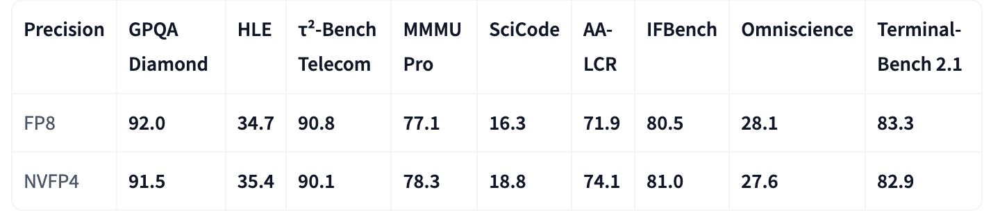

*两条在 H100 上没有走通的路：换稀疏 MoE 模型，以及 4-bit 权重。按成本模型的因子解释为什么，以及到 B200 上会怎样。*

系列（按顺序阅读）：1. [混合注意力 LLM 离线推理](/HybridModelConcurrency/) · 2. [推理瓶颈在哪](/InferenceCostModel/) · 3. [提高推理 QPS](/OfflineInferenceOptimizationLog/) · 4. [稀疏 MoE 与 FP4](/BeyondH100/)

**背景速记**：

- 基线模型 Qwen3.8-27B：48 层 GDN（线性注意力，每请求固定大小的递归状态）+ 16 层 full attention（KV cache 随长度增长），FP8 权重单卡部署在 H100 上。
- 负载是离线批推理：每请求约 12K 输入、约 260 输出，prefill 占大头，只看吞吐。
- 因子来自[第 2 篇](/InferenceCostModel/)的每请求 GPU 时间拆分：

$$T_{gpu} \approx N_{\text{in}} \times c_{\text{in}} + \frac{N_{\text{out}}}{B} \times c_{\text{step}}$$

$$N_{\text{in}}$$、$$N_{\text{out}}$$ 是输入、输出 token 数；$$c_{\text{in}}$$ 是 prefill 每 token 成本（受算力限制）；$$c_{\text{step}}$$ 是 decode 一步成本（受带宽限制，约等于把权重和状态搬一遍）；$$B$$ 是运行时并发。

---

## 1. Qwen3.8-Flash-Next

**架构对照**

| 项 | Qwen3.8-27B | Qwen3.8-Flash-Next |
|-|-|-|
| 架构 | dense | sparse MoE |
| 总参数 / 每 token 激活 | 27B / 27B | 125B / 约 6B |
| 层数 | 64 = 48 GDN + 16 full attention | 48 = 36 GDN + 12 QSA |
| hidden | 5120 | 2560 |
| FFN | dense SwiGLU，intermediate 17408 | MoE 512 专家 top-10 + 1 shared |
| attention | full attention | QSA 稀疏 attention |
| 条件记忆 | 无 | n-gram PLE 表 2000 万条 × 8 head，约 50 GB |
| 每 token KV（FP8 KV） | 约 32 KB | 约 12 KB |

结构性优势：

1. n-gram PLE（逐层查表嵌入）：高频短语整体查表注入表示，把这部分表示计算换成查表（查表近零 GPU 成本）；不缩短序列，$$N_{\text{in}}$$ 不变。
2. 激活参数少（每 token 约 6B）+ 层数 64 → 48：FFN 算术量每 token 约 −85%，直接降 $$c_{\text{in}}$$。
3. QSA 稀疏 attention：长上下文中每个 query 每层只对挑出的约 2K token 做 attention，attention 成本与上下文长度解耦。

**公开 benchmark 对照**（选与结构化抽取、长上下文、指令遵循最接近的几项）

| Benchmark | 侧重 | Qwen3.8-27B | Flash-Next |
|-|-|-|-|
| ExtractBench（LlamaIndex） | 结构化抽取 → JSON | 89.75 | 89.88 |
| AA-LCR | 长上下文找回与理解 | 72.63（bf16） | 71.9（FP8） |
| IFBench | 指令约束遵循 | 80.07（bf16） | 80.5（FP8） |
| GPQA Diamond | 知识推理 | 88.92（bf16） | 92.0（FP8） |

**在 H100 上为什么没走通**

官方 FP8 版 [Qwen3.8-Flash-Next-FP8](https://huggingface.co/Qwen/Qwen3.8-Flash-Next-FP8) 共 172 GB，在 4×H100 上只能 TP4 + EP4 部署（张量并行切 4 卡，专家并行把 512 个专家分到 4 卡）。27B-FP8 每卡一个副本，4 张卡就是 4 倍单卡吞吐，所以 Flash-Next 占 4 张卡要划算，吞吐需要达到 27B-FP8 单卡的 4 倍；实测在相同默认配置下只有约 1.7 倍。

归因：理论算术量优势（6B 激活 + 48 层）被 TP4 形态化解了。H100 的显存容量是这个模型部署的最大问题：TP4 每层都要做跨卡 all-reduce，用 nsys（NVIDIA 的性能分析工具）看占 kernel 时间 13–19%，GPU 还出现空闲。

如果能解决显存问题、让 TP=1，理论上 Flash-Next 的计算量优势就能兑现。NVIDIA 发布了 NVFP4 版本，可以单卡部署：

- PTQ 版（训练后直接量化，124 GB）：[nvidia/Qwen3.8-Flash-Next-NVFP4](https://huggingface.co/nvidia/Qwen3.8-Flash-Next-NVFP4)
- QAD 版（量化感知蒸馏，96 GB）：[nvidia/Qwen3.8-Flash-Next-FP4-Local](https://huggingface.co/nvidia/Qwen3.8-Flash-Next-FP4-Local)

PTQ 版 benchmark（FP8 vs NVFP4，来自 NVIDIA 模型卡）：

---

## 2. NVFP4 与 B200

为什么量化到 FP4（NVFP4、MXFP4 都是 4-bit 浮点格式，区别在 scale 的粒度与格式）：本质上是减少 weight，释放显存，提高并发，加速 decode。prefill 是 compute-bound，除非有 FP4 Tensor Core（Blackwell 有），否则算不快。

H100 没有原生 FP4 tensor core，所以思路是在 kernel 内反量化后用 FP8 算力执行。我把 [Humming](https://github.com/vllm-project/humming) kernel 从 vLLM 迁到 SGLang 做了测试。

**Humming 机制**：权重以 MXFP4 存放，GEMM kernel 内先反量化到 fp8，再走 H100 的 FP8 tensor core（W4A8：权重 4-bit、激活 8-bit）。算力负载相同，4-bit 只省权重显存和权重搬运带宽，不省任何计算。理论上 prefill 算力 bound，无收益；decode 带宽 bound（每步搬全量权重），权重字节减半有收益。收益大小由负载的 decode 份额决定。

**实测**（Qwen3.8-27B PTQ MXFP4）：decode 每 token 时间 −22% 确实存在，但被输出变长 17% 抵消，端到端吞吐持平。质量上，从 FP8 权重量化来的 4-bit 版本出现输出截断与 JSON 字段失控，从 bf16 权重量化来的版本输出分布仍有偏移。

**结论**：kernel 机制的收益在 decode 侧兑现，但问题出在格式质量和 prefill-heavy 的负载形状。H100 上 4-bit 没有净收益。NVFP4 真正起飞要靠 Blackwell 的原生 FP4 GEMM tensor core（算力翻倍 + 免反量化）。

**B200 vs H100**，按成本模型的因子分类：

| 项 | H100（SXM） | B200 | 打到的因子 |
|-|-|-|-|
| FP4 tensor core | 无（只能 kernel 内反量化） | 原生，FP8 的 2 倍算力 | $$c_{\text{in}}$$（prefill GEMM） |
| FP8 算力（dense） | 1 | 4.5 倍 | $$c_{\text{in}}$$ |
| HBM 容量 | 80 GB | 180 GB | $$B$$（状态池）、TP 形态 |
| HBM 带宽 | 3.35 TB/s | 8 TB/s | $$c_{\text{step}}$$（decode） |
| NVLink（每卡双向） | 900 GB/s | 1.8 TB/s | 多卡通信 |

总结：

- NVFP4 PTQ 版约 124 GB，B200 单卡 180 GB 放下权重后余约 56 GB 给 KV 和 GDN 状态。TP=1 时 all-reduce 通信整项消失，多卡调度同步也随之消失。
- 如果不想用 NVFP4 精度，FP8 版也可以在 B200 上试 TP=2 / EP=2。
